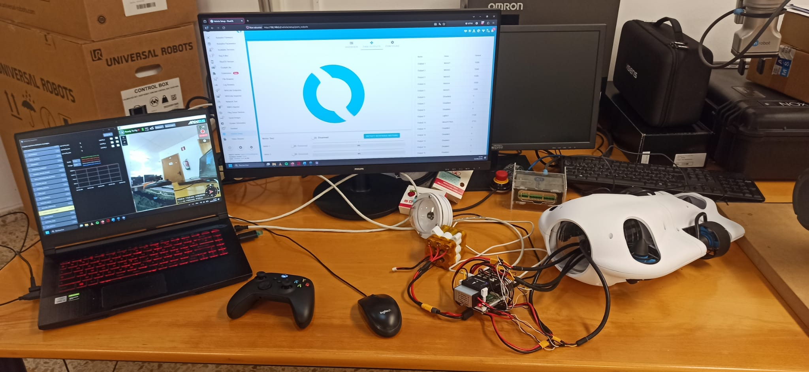

# Underwater Acoustic Communication for AUVs and ROVs


## 1. Introducción

La comunicación es uno de los aspectos más importantes en el desarrollo de vehículos submarinos, tanto autónomos (AUV) como operados remotamente (ROV). Permite transmitir información entre el vehículo y la estación de superficie, como datos de sensores, información de navegación y órdenes de control.

Sin embargo, las comunicaciones bajo el agua presentan dificultades diferentes a las de los sistemas convencionales. Las ondas de radio tienen muchas limitaciones en este entorno, por lo que las ondas acústicas se utilizan habitualmente para transmitir información a través del agua.

El objetivo de este proyecto es estudiar el comportamiento de las comunicaciones acústicas submarinas mediante un modelo desarrollado en Python. Se analizarán factores como la distancia, la frecuencia, la atenuación, el ruido y la capacidad de transmisión, con el fin de comprender qué prestaciones se pueden conseguir en diferentes condiciones.

## 2. Motivación y experiencia previa

Este trabajo también está relacionado con mi experiencia anterior en el desarrollo de un vehículo submarino operado remotamente (ROV) durante mi estancia en la USC.

En aquel proyecto trabajé en el desarrollo de una plataforma submarina que integraba diferentes sistemas electrónicos y de control, entre ellos Raspberry Pi 4, Pixhawk 6C y ArduSub.

La arquitectura de comunicación utilizaba una conexión Ethernet mediante un cable tether entre el vehículo y la estación de superficie. También se utilizaron MAVLink para el intercambio de datos de control y telemetría, y WebRTC para la transmisión de vídeo.

Esta experiencia me permitió conocer algunos de los retos relacionados con la comunicación y el control de vehículos submarinos.

A partir de este trabajo surge el interés por estudiar otra alternativa de comunicación: la transmisión acústica bajo el agua. En este proyecto se analizará su comportamiento y se estudiarán sus posibilidades de aplicación en sistemas AUV y ROV.

## 3. Objetivos del proyecto

Los principales objetivos son:

- Estudiar la absorción acústica del agua mediante la fórmula de Thorp.
- Analizar las pérdidas de propagación en función de la distancia y la frecuencia.
- Modelar el ruido ambiente y calcular la relación señal-ruido (SNR).
- Estimar la capacidad teórica del canal utilizando la fórmula de Shannon.
- Comparar diferentes técnicas de modulación.
- Analizar la relación entre el alcance de comunicación y la tasa de datos.
- Calcular la latencia de propagación de las señales acústicas.
- Contrastar los resultados obtenidos con las especificaciones de módems acústicos comerciales.

## 4. Metodología

El modelo se ha desarrollado en Python mediante una serie de scripts que permiten estudiar la comunicación acústica submarina.

Primero, se ha calculado la absorción acústica mediante la fórmula de Thorp y se han estimado las pérdidas de propagación para distintas distancias y frecuencias. Después, se ha calculado la relación señal-ruido (SNR) y se ha estimado la capacidad teórica del canal mediante la fórmula de Shannon.

También se han comparado distintas modulaciones y se ha calculado la latencia de propagación. Finalmente, los resultados se han contrastado cualitativamente con especificaciones publicadas de módems acústicos comerciales.

## 5. Herramientas utilizadas

- Python
- NumPy
- Matplotlib
- Git y GitHub

## 6. Organización del repositorio

- `data/`: datos y parámetros utilizados en las simulaciones.
- `src/`: código fuente del modelo de comunicación.
- `notebooks/`: cálculos, pruebas, experimentos y análisis.
- `docs/`: documentación, referencias y memoria del proyecto.
- `previous_rov_project/`: material seleccionado del proyecto ROV anterior, utilizado como contexto de aplicación.

## 7. Resultados

El modelo permite analizar cómo la distancia y la frecuencia afectan a la comunicación acústica submarina. Se han generado gráficas de pérdidas de propagación, SNR y capacidad teórica del canal, además de comparaciones entre distancia y tasa de datos.

Los resultados muestran el compromiso entre alcance y tasa de transmisión. También se ha considerado la latencia de propagación y se han contextualizado las estimaciones mediante una comparación cualitativa con módems acústicos comerciales.

Los valores obtenidos son estimaciones de un modelo simplificado y dependen de los parámetros utilizados.

## 8. Estado del proyecto

Modelo implementado y analizado. Los scripts y la documentación del proyecto están disponibles en este repositorio.

## 9. Referencias iniciales

- Zia, M. Y. I., Poncela, J. y Otero, P. (2021). *State-of-the-art underwater acoustic communication modems: Classifications, analyses and design challenges*. Wireless Personal Communications, 116(2), 1325–1360. https://doi.org/10.1007/s11277-020-07431-x

- Stojanovic, M. (2006). *On the relationship between capacity and distance in an underwater acoustic communication channel*. Proceedings of WUWNet '06. https://doi.org/10.1145/1161039.1161049

## 10. Cómo ejecutar el modelo

Desde la carpeta raíz del repositorio, activa el entorno virtual y ejecuta los scripts:

```bat
.venv\Scripts\activate
py src\plot_thorp.py
py src\plot_propagation_loss.py
py src\plot_snr.py
py src\plot_capacity.py
py src\propagation_delay.py
py src\modulation_comparison.py
